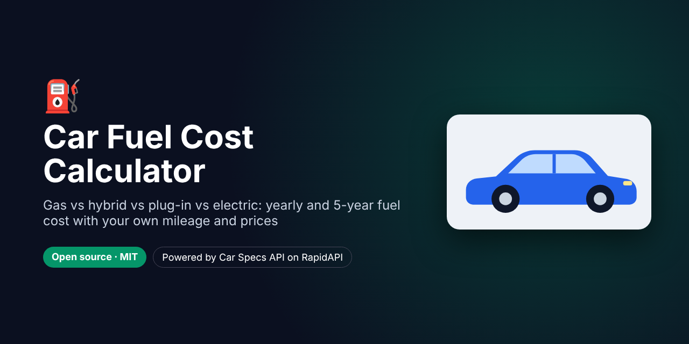

# Car Fuel Cost Calculator – Gas vs Hybrid vs Plug-in vs Electric



> **For faster support reply, contact us on Telegram: [@pintoflow](https://t.me/pintoflow)**

**How much will this car cost to fuel?** Pick up to **3 cars** by year, make and model, enter **your yearly mileage, gas price and electricity price**, and see:

- 💵 **Yearly and multi-year fuel or charging cost**, and **cost per 100 miles**
- 🏆 The **cheapest car** and how much it **saves** over the period
- ⚡ Gallons and **kWh per year**, with plug-in hybrids split by the share of miles you drive on electricity
- 🌍 **Tailpipe CO₂ per year**
- 📊 The EPA's own annual cost estimate, for reference

It uses the **official US EPA ratings** (MPG, MPGe, kWh/100 mi) for every car, SUV, van and light truck from **1984 to next year**. Node.js with **zero dependencies**.

Powered by the **[Car Specs API](https://rapidapi.com/belchiorarkad-FqvHs2EDOtP/api/car-specs-api)** on RapidAPI.


<sub>Screenshot in demo mode with fictional cars and sample numbers.</sub>

---

## Why this exists

"EV vs gas calculator", "fuel cost calculator" and "how much does it cost to charge an electric car" are evergreen searches, and banks, utilities and EV sites all publish their own versions. This one pulls **real EPA figures for the exact model and engine**, so users don't have to look up MPG themselves.

## How it's calculated

```
gas car       cost = miles / MPG × gas price
electric car  cost = miles × kWh per 100 mi / 100 × electricity price
plug-in       cost = (electric share × EV cost) + ((1 − share) × gas cost)
CO₂           = EPA g CO₂ per mile × miles driven on gas
```

## Quick start

```bash
git clone https://github.com/BelNaruto/car-fuel-cost-calculator.git
cd car-fuel-cost-calculator

node server.js                                 # demo mode (fictional sample data)
RAPIDAPI_KEY=your_rapidapi_key node server.js  # live data
```

Open **http://localhost:3000**. Requires Node.js 18 or newer, and there's nothing to install.

Get a key: **https://rapidapi.com/belchiorarkad-FqvHs2EDOtP/api/car-specs-api**

## API endpoints used

| Endpoint | Used for |
|---|---|
| `GET /makes?year=`, `GET /models?make=&year=&source=epa`, `GET /trims` | Year → make → model → engine picker |
| `GET /specs/{id}` | Full spec sheet: `fuelEconomy` (MPG, `electric.kWhPer100Miles`, range), `emissions`, `costs` |

## Ideas

- An **EV savings calculator** for a dealership or EV charger installer
- A **company-car / fleet** running-cost comparison
- An embeddable widget for a **car blog** or **utility** website

## Deploy

Deploy to **Google Cloud Run, Render, Railway, Fly.io** or any VPS with the start command `node server.js` and the env var `RAPIDAPI_KEY`.

## Related projects

- 🚗 [Car Comparison Tool](https://github.com/BelNaruto/car-comparison-tool): compare up to 4 cars side by side
- 🔎 [Free VIN Decoder](https://github.com/BelNaruto/free-vin-decoder): full specs, MPG, safety and photos from a VIN
- 📘 [Car Specs API docs and examples](https://github.com/BelNaruto/car-specs-api)

## Support

> **For faster support reply, contact us on Telegram: [@pintoflow](https://t.me/pintoflow)**

API: https://rapidapi.com/belchiorarkad-FqvHs2EDOtP/api/car-specs-api

---

MIT License. Estimates only: real costs depend on driving style, weather, charging losses and local prices.

**Keywords:** fuel cost calculator, ev vs gas calculator, gas vs electric car cost, car running cost calculator, mpg calculator, cost to charge electric car, hybrid vs gas, plug-in hybrid calculator, car specs api
